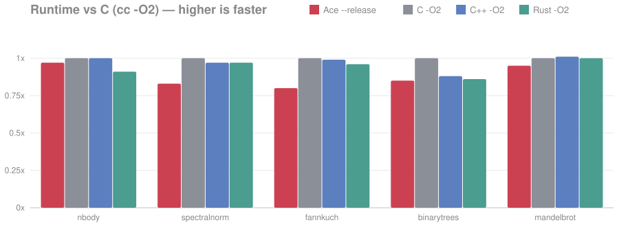
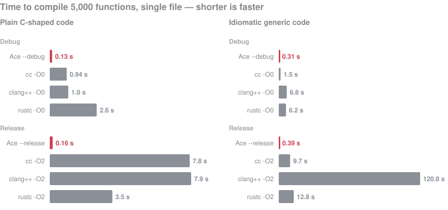

# Ace

**Close to C's speed, with C's control and without its traps.**

Ace compiles straight to native machine code, with no runtime, no garbage
collector and no hidden allocations. It keeps C's model: you manage memory,
you see every cost. It drops what makes C painful: undefined behavior,
headers, macros and silent conversions.

<p>
  <a href="docs/lsp.md"></a>
  <a href="docs/mcp.md"></a>
  
</p>

> [!WARNING]
> **Pre-alpha.** Breaking changes are expected, and neither issues nor pull
> requests are accepted before v1.

```ace
import fmt

Point: struct { x: int, y: int }

Point.sum(const self): int {
    return self.x + self.y
}

main(): int {
    p: Point = Point { x = 3, y = 4 }
    fmt.printf("sum: %d\n", p.sum())
    return 0
}
```

> [!NOTE]
> Ace currently supports only macOS on Apple Silicon (AArch64). Linux and
> Windows will follow.

## Speed



Five Benchmarks Game programs (`bench/standard/`), each running the same
algorithm in every language, single-threaded, with no SIMD or intrinsics, on
Apple Silicon, against `cc -O2`. Ace's own optimizer is young: it stays
within 5% of C on `nbody` and `mandelbrot` and runs the rest at 80–85% of
C's speed; closing the gap is ongoing work.



Ace compiles **5x faster** than `cc -O0` and **25x faster** than `cc -O2`
(`bench/compiler/`): it writes machine code directly, with no assembler or
LLVM in between. Each language's code uses its own containers, generics, and
polymorphism, built with its compiler's defaults: `rustc` splits code
generation into 16 parallel units, while `cc`, `clang++`, and Ace compile the
file on one thread. `bench/chart.py` draws the charts.

## Ace vs C, C++ and Rust at a glance

| | C | C++ | Rust | **Ace** |
|---|---|---|---|---|
| Undefined behavior | everywhere | everywhere | only in `unsafe` | none: an operation works, traps, or does exactly what the machine does |
| Memory | manual | RAII, hidden destructors | ownership and borrow checker | manual, with `defer` and debug-build checks |
| Errors | return codes, `errno` | exceptions | `Result` and `?` | plain values, handled where they occur |
| Hidden costs | implicit conversions | copies, constructors, exceptions | `Drop`, implicit monomorphization | none: no implicit conversions, copies or allocations |
| Generics | macros | templates | traits | explicit: `Array[int]` |
| Polymorphism | hand-made function-pointer tables | inheritance, `virtual` | traits, `dyn` | contracts: explicit vtable values |
| Code organization | headers, preprocessor | headers, preprocessor | crates | modules; no headers, any declaration order |
| Toolchain | compiler, build system, package manager: pick each | same as C | `cargo`, LLVM | one binary: compiler, packages, tests, no LLVM |
| Learning curve | small | huge | steep | small |

## What Ace promises

- **Nothing happens behind your back:** every allocation, copy, conversion and
  error path is in the source.
- **No undefined behavior:** the optimizer never assumes your code "can't
  happen"; it uses only facts the hardware guarantees or you stated.
- **Cheap safety:** types are always explicit, and variables must be
  initialized before use. Debug builds trap on overflow, out-of-bounds access
  and misuse; release builds pay nothing for those checks.
- **Ready for real programs:** an HTTP server, a JSON parser, a regex engine,
  SDL graphics and a logic simulator are in this repo, all written in Ace.
- **Written in itself:** Ace's own compiler is written in Ace and compiles
  itself; its output matches the C compiler's byte for byte. The editor's
  language server is written in Ace too.

## What's included

| Path | Contents |
| --- | --- |
| `std/` | Standard library: `fmt`, `mem`, `str`, `ascii`, `utf8`, `bits`, `map`, `array`, `sort`, `file`, `math`, `time`, `net`, `poll`, `sys`, `signal`, `exec`, `thread`, `atomic`, `test` |
| `pkg/` | First-party packages: `json`, `regex`, `http`, `sdl` |
| `demo/` | Runnable programs: HTTP client, single-threaded, multi-threaded, and event-loop servers, the binbox logic simulator, JSON and regex tools, a packet sniffer, SDL3 window, rotating and raycast cubes |
| `bench/` | Benchmarks for the compiler, language features, `std`, and packages |
| `selfhost/` | Self-hosted compiler in Ace (in progress); `selfhost/check.sh` compares its output with `./ace` |
| `lsp/` | `ace-lsp`, the language server, in Ace over the selfhost front-end |
| `editors/vscode/` | VS Code extension: highlighting, outline, go to definition, hover |

## Build

Requires a C11 compiler.

```sh
make
```

This produces `./ace`.

## Compile and run

```sh
./ace -o hello hello.ace   # compile, link, and produce an executable
./hello
```

Other modes:

```sh
./ace file.ace             # typecheck only
./ace -c file.ace          # emit a Mach-O arm64 object
./ace --tokens file.ace    # dump tokens
./ace --ast file.ace       # dump the syntax tree
./ace --ir file.ace        # dump the intermediate representation
./ace --report file.ace    # show compile statistics
```

Generated binaries carry DWARF line information, so LLDB can step through Ace
source.

## Test

```sh
make test
```

## Editor support

The [Ace VS Code extension](editors/vscode/README.md) provides syntax
highlighting, the document outline, go to definition, and hover with doc
comments. The last three come from `ace-lsp`, which the packaged extension
bundles; [docs/lsp.md](docs/lsp.md) explains how it works.
